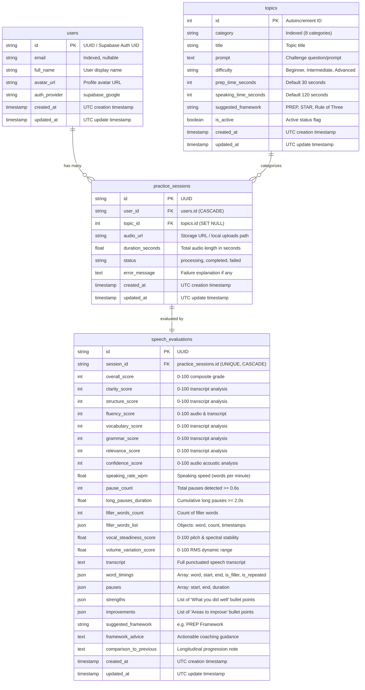

# Clario Database Schema

Database architecture for the Clario articulation tool.

## Relationships

| Parent Table | Relationship | Child Table | Foreign Key | On Delete |
|---|---|---|---|---|
| `users` | 1-to-Many | `practice_sessions` | `practice_sessions.user_id` | `CASCADE` |
| `topics` | 1-to-Many | `practice_sessions` | `practice_sessions.topic_id` | `SET NULL` |
| `practice_sessions` | 1-to-1 | `speech_evaluations` | `speech_evaluations.session_id` | `CASCADE` |
